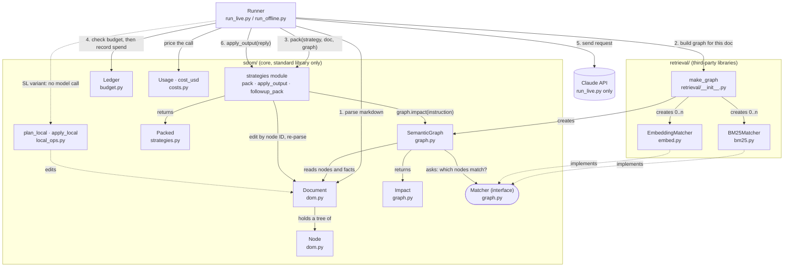
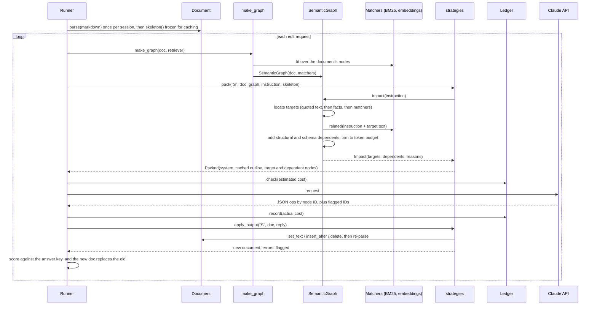

# Architecture: how the pieces fit

The Document does not call the strategies. A **runner** (`run_live.py`, or `run_offline.py` for the
simulator) controls each edit. It parses the document, builds a graph over it, asks a strategy to
package the context, sends that to the model, and gives the reply back to the strategy, which applies it.
The strategies are plain functions in one module, not classes.

## Who calls whom

## One edit, step by step (strategy S)

## What each part is for

| Part | Role | Why it is separate |
|---|---|---|
| `Document` / `Node` (`dom.py`) | Parses markdown into a tree of sections and items with stable IDs. Renders it back, makes the outline ("skeleton"), and applies edits by ID. | Everything else addresses the document by node ID, not by text position. |
| `SemanticGraph` (`graph.py`) | For an instruction, finds the **targets** and the **dependents** that the edit might make inconsistent. Returns them as an `Impact`. | It holds the research idea: the dependency graph. It is kept apart so its pieces can be switched on and off for ablations. |
| `Matcher` (interface) | Contract any retriever must meet: `locate()` and `related()`. | Lets BM25 and embeddings be swapped or combined without changing the graph. |
| `BM25Matcher`, `EmbeddingMatcher` (`retrieval/`) | Keyword and meaning-based search over the nodes. | They need third-party libraries, so they live outside the dependency-free core. |
| `make_graph` (`retrieval/__init__.py`) | Factory: builds the graph with the retriever mix chosen on the command line (default `all-bge`). | One place defines the variants that were compared. |
| strategies module (`strategies.py`) | For each strategy (B0, B1, B2, S), decides what context to send, then applies the model's reply. | Keeps the comparison fair: every strategy goes through the same pack-and-apply steps. |
| `Packed` | The request content, split into a cacheable part and a per-request part. | Prompt caching depends on the cached prefix staying byte-for-byte identical. |
| `local_ops.py` | Simple edits done without calling the model (the SL variant). | Tests whether some edits need no model at all. |
| `Ledger` (`budget.py`) | Refuses a call that would exceed the budget, and records every spend. | Spending limit for an autonomous agent. |
| `Usage` / `cost_usd` (`costs.py`) | Token counts and list-price cost. | Shared by the simulator and live runs, so estimates and measured costs are priced the same way. |

The four strategies: **B0** sends the whole document and gets the whole document back. **B1** sends the
whole document (cached) and gets find-and-replace edits back; this is the strong baseline. **B2** sends
only the target section. **S** (semantic DOM) sends a cached outline plus the targets and their dependents.
