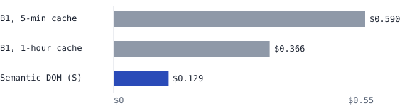
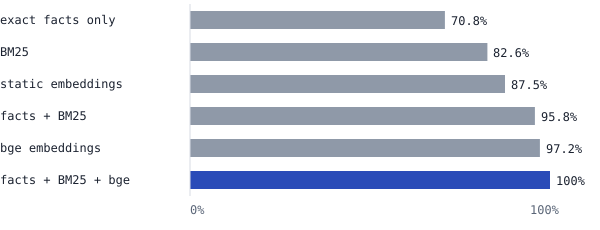

# Editing documents with an LLM, one node at a time

*Research note, October 2026.*

A harness-side "semantic DOM" cut the cost of LLM edits by 22–58% on documents from 4k to 24k tokens, compared
with the strongest baseline I could build (whole document in context, prompt caching, find-and-replace edits),
with no detectable quality difference. On a 400-token CV it cost 57% more. Per edit it was about as fast as the
baseline, once the document was indexed when opened.

| Result | Detail |
|---|---|
| **−44% cost**, baseline cache always warm | 24 unseen edits on 4 documents, 3 runs. 73/75 fact checks passed for both (97.3%) |
| **−65% cost**, realistic pauses | 24k-token ADR set, 2–12 minute pauses between edits, 3 runs ($0.129 vs $0.366) |
| **Level on speed**, end to end | 5.9 s vs 6.6 s per edit (3 runs). Indexing at open takes 0.3–17 s from 2k to 100k tokens (laptop CPU) |

Model: Claude Opus 5.5 (effort low) · 111 test edits across 18 documents · $18.74 of API spend in total.
Code, documents and the results behind every number are in this repository.

**How this was built.** I designed the experiment and its rules (baselines, pre-registered answers, budget, quality
gates) and reviewed every result. The code was written by Claude Code running as an autonomous engineering loop
under those rules, set out in [`.specify/memory/constitution.md`](../.specify/memory/constitution.md). I'm an
architect, not a Python developer.

## When to use it

Size matters more than document type. The semantic DOM pays a roughly fixed cost on every edit: an outline, the
output format and the nodes it sends. The baseline pays to read the whole document, but cached reads cost only 5%
of the normal input price. On a small document that cached read is cheaper than the semantic DOM's overhead. As
the document grows, the baseline's read grows with it while the semantic DOM's request stays about the same size.

| Document | Size (est. tokens) | Baseline session | Semantic DOM session | Difference |
|---|---:|---:|---:|---:|
| Sample CV (best-resume-ever) | 0.4k | $0.013 | $0.021 | **+57%** |
| log4brains ADRs | 4.0k | $0.052 | $0.040 | −22% |
| Bonterms cloud contract | 8.4k | $0.100 | $0.069 | −31% |
| GOV.UK Infrastructure ADRs | 24k | $0.263 | $0.110 | −58% |

Mean of 3 runs, 6 edits per document, edits fired back to back so the baseline's cache is always warm (its best
case). Spread is under ±$0.008 for every cell. Sizes are characters ÷ 4; real token counts are about 1.2× higher.

| Document size | Recommendation |
|---|---|
| A page or two (under ~1k tokens) | Send the whole document with prompt caching. The semantic DOM cost 57% more. |
| Between 1k and 4k tokens | Not measured here; the break-even is somewhere in this range. |
| 4k tokens and up: ADR logs, contracts, long specs | Use a semantic DOM: 22–58% cheaper with a warm cache, growing with size, and 65% at 24k with real pauses. |
| Beyond the context window | Some selective approach like this is required (not tested here). |

- **Pauses widen the gap.** With a 5-minute cache, any longer pause makes the baseline re-read the whole document
  at full price.
- **Exact renames are the exception at any size.** The harness can apply "X has rebranded as Y" locally, with no
  model call, while every LLM-based approach pays to rewrite each mention.
- **The thresholds are specific to Claude Opus 5.5 pricing.** With relatively more expensive cache reads the
  break-even falls, and with cheaper ones it rises. The principle carries over: a fixed cost per edit against a
  cost that grows with the document.

## The problem

Generated documents are rarely accepted first time. People tweak a bullet, fix a date or rename a term. Each tweak
has two costs:

- **Tokens and time.** Rewriting the whole document to change one line is slow and expensive. Keeping the whole
  document in context with prompt caching is cheap while the cache is warm, but caches expire. With the default
  5-minute cache, a person who pauses to think pays to re-read the whole document.
- **Knock-on edits.** Changing a start date should also change "12 years of experience" in the summary. Changing a
  notice period from 90 days should also change "three months' notice" in the key-terms schedule. Missing these is
  how edited documents drift out of consistency.

## What I built

A harness that parses the document into addressable nodes (document → section → item), builds dependency edges
between them, and sends the model only what an edit needs:

> parse into nodes → locate target → follow edges → cached outline + target + dependents → model returns node-ID
> patches → apply, re-parse

- **Edges:** structural (a section and its items), per-document-type schema rules (a CV summary depends on the
  experience section), and shared facts (numbers, durations normalised to days, defined terms, ADR references,
  file names).
- **Retrieval:** a hybrid of those exact facts, BM25 keyword matching and `bge-small` sentence embeddings finds the
  target and related nodes when the request doesn't quote the text.
- **Indexing at document open:** the graph, the BM25 index and an embedding for every node are built when the
  document opens, together with a small request that writes the prompt cache. Edits then reuse them.
- **Patches by node ID** (`edit`, `insert_after`, `delete`). Node IDs are positional and the document is re-parsed
  after each edit (see [Limitations](#limitations)).

The idea isn't new in isolation: coding agents already send a condensed map of a codebase plus targeted
search-and-replace edits, and retrieval over chunks is standard. What this note adds is the measurement: against a
strong cached baseline, with answers fixed in advance, across document sizes, and with the dependency graph tested
separately from retrieval.

## How I tested it

### Strategies

| ID | Strategy |
|---|---|
| B0 | Full rewrite: whole document in, whole document out |
| B1 | Whole document in context, prompt caching, find-and-replace edits. The baseline to beat, run with both 5-minute and 1-hour caches |
| **S** | **Semantic DOM: cached outline + target + dependents, node-ID patches** |

### Documents and protocol

- **Development set:** 8 synthetic documents (CVs, ADR logs, contracts; 1k–100k tokens) and 3 public ones
  (Backstage and GOV.UK ADRs, a sample résumé). A private CV was also used during development; it is not included.
- **Two held-out sets** the harness was never tuned on. Set 1: Ministry of Justice ADRs, the Common Paper cloud
  contract and a sample CV, with requests that quote the text to change. Set 2: log4brains and GOV.UK
  Infrastructure ADRs, the Bonterms cloud contract and a sample CV, with every request in plain language ("tighten
  the decision about named exports"). All are public and cited with pinned commits in
  [`evalset/real/SOURCES.md`](../evalset/real/SOURCES.md).
- **Pre-registration:** the expected answers for each held-out set were drafted by Claude Code within the same loop
  that built the harness, reviewed by me, and committed to git before any code ran on it. Retriever settings were
  frozen before scoring.
- **Scoring:** did every node that must change get changed, did fact checks pass (e.g. no "Section 18
  (Confidentiality)" left), and were distractors left alone (eight unrelated "30 days" clauses in one contract).

## Results

### With the baseline's cache always warm, it costs 44% less, with no detectable quality difference

| Strategy | Session cost (mean ± sd) | Fact checks, 3 runs |
|---|---:|---:|
| B1 (whole doc, cached) | $0.428 ± 0.012 | 73/75 (97.3%) |
| **S (facts + BM25 + bge)** | **$0.240 ± 0.003** | **73/75 (97.3%)** |
| S (facts + BM25 only) | $0.195 ± 0.006 | 69/75 (92.0%) |

Held-out set 2: 24 plain-language edits on 4 documents, fired back to back. The one edit that failed for every
strategy (rewriting all mentions of Elasticsearch in one ADR) was the model making partial rewrites; B1 sees the
whole document and missed it just as often. Per-document costs are in [When to use it](#when-to-use-it).

### Under realistic pacing, the saving is larger

Mean of 3 editing sessions per strategy (6 edits each) on the GOV.UK Infrastructure ADRs (24k tokens), with pauses
of 2, 7, 3, 12 and 4 minutes between edits. Spread is small: ±$0.002 for S, ±$0.002 and ±$0.010 for B1. S's cost
includes writing the prompt cache when the document opens. Fact checks: S 29/30, B1 1-hour 28/30, B1 5-minute
27/30, every miss in the same Elasticsearch rename. Each session had its own cache, so sessions could not warm
each other.

### Per edit, it is as fast as the baseline

Counting the harness's own work (finding targets, BM25, embeddings) as well as model time, over the same paced
sessions:

| Strategy | Model time per edit | First edit, end to end | Later edits, end to end | Session mean, end to end |
|---|---:|---:|---:|---:|
| B1, 1-hour cache | 6.6 s | 5.1 s | 6.9 s | 6.6 s |
| **S** | **3.7 s** | **3.1 s** | **6.4 s** | **5.9 s** |

The model answers S faster because it reads far less, but the harness spends 0.3–4.8 s per edit on retrieval, so
end to end the two are level. The indexing done when the document opens is outside these figures. Timed offline in
a foreground process (median of 5 runs, embedding model already loaded):

| Document | Size (est. tokens) | Nodes | Index at open | Of which DOM + graph + BM25 |
|---|---:|---:|---:|---:|
| Synthetic ADR set | 2.1k | 73 | 0.3 s | 0.01 s |
| Synthetic contract | 3.0k | 67 | 0.4 s | 0.01 s |
| Bonterms contract | 8.4k | 147 | 1.3 s | 0.06 s |
| Backstage ADRs | 9.9k | 307 | 2.1 s | 0.07 s |
| Synthetic contract | 20k | 329 | 2.6 s | 0.16 s |
| GOV.UK Infrastructure ADRs | 24k | 677 | 5.6 s | 0.26 s |
| MoJ ADRs | 36k | 1,319 | 8.7 s | 0.51 s |
| Synthetic ADR set | 100k | 3,421 | 16.6 s | 3.5 s |

Indexing costs roughly 5–9 ms per node, almost all of it embeddings, so it scales with the number of nodes more
than with tokens. Up to about 20k tokens it finishes in under 3 s, before a person starts their first edit. On a
100k-token document, someone who edits immediately would wait about 17 s once. These are laptop CPU figures; a GPU
or a hosted embedding service would be faster. In the live sessions, which ran as background processes, indexing
took 6–79 s; on this Windows laptop a background process indexed 3–5× slower than a foreground one.

### The retrieval method decides whether it works

Share of the nodes that had to change which made it into the model's context, on held-out set 2 (24 edits). Live,
one run each, these became 20/25, 16/25, 21/25, 23/25, 23/25 and 25/25 fact checks.

Matching exact facts alone found everything on the development set and on held-out set 1, where requests quote the
text. On plain-language requests it found 70.8%, because "the decision about named exports" contains no fact to
match. Keyword search and embeddings each catch different misses, and combining exact facts, BM25 and bge
embeddings found everything on both held-out sets. Settings tuned on the development set and untuned defaults
scored within 1.5 points of each other for every method in the chart.

### The dependency graph is what finds the knock-on edits

Removing one kind of edge at a time, offline, across all 18 documents (fact-matching graph, share of must-change
nodes in context):

| Edit kind | Full graph | Without schema edges | Without fact edges | Without structural edges | Target only |
|---|---:|---:|---:|---:|---:|
| CV summary after a date change (schema ripple) | 100% | 58% | 100% | 100% | 58% |
| Same fact in other words (paraphrase ripple) | 100% | 100% | 58% | 100% | 58% |
| Same fact repeated (literal ripple) | 100% | 100% | 99% | 94% | 86% |
| ADR status change (status) | 93% | 93% | 93% | 29% | 29% |

"Target only" is roughly what sending just the target section gives: it misses about four in ten knock-on edits
of the first two kinds. "Three months' notice" and a "ninety (90) days" clause are linked because both durations
normalise to 90 days. Full results: [`results/ablation.md`](../results/ablation.md).

### Things the models got right that my answers didn't

- Asked to replace Concourse with GitHub Actions in one MoJ ADR, B1 marked the record superseded by the existing
  ADR 040 instead of rewriting it. That is arguably the better practice; my expected answer demanded a rewrite.
- Asked to retitle an MoJ ADR, B1 and S also updated a third reference my answer key had missed.

Both are recorded as scored; I didn't change the answer key after seeing results.

## Where it doesn't win

- **Small documents.** On a 400-token CV, S cost 57% more than B1 with a warm cache. The outline and output format
  overhead don't pay for themselves.
- **Not faster, only level.** 5.9 s vs 6.6 s per edit end to end, and only because indexing happens when the
  document opens. That takes about 6 s at 24k tokens and 17 s at 100k on a laptop CPU.
- **No quality gain.** S matched B1 rather than beating it, because B1 sees the whole document. With about 25 fact
  checks per run, "no detectable difference" is the most this sample supports; a gap of a few points could go
  unseen.
- **Exact-fact matching alone overfits to quoted requests.** It found everything when requests quoted the text and
  70.8% when they didn't.
- **Full rewrite (B0) is not a realistic competitor:** on small documents it cost 6.8–8.2× more than B1 and was
  2.6–6.0× slower.

## Limitations

- One model (Claude Opus 5.5 at low effort). Other models and effort levels are untested.
- Small samples: 42 held-out edits, 3 runs of the 24 plain-language edits, 4 documents in the cost-by-size table.
- The expected answers were drafted by Claude Code, the same agent that built the retriever, and reviewed by me.
  Committing them before any run stops tuning to the results, but not a test writer who knows what the system can
  do. Inspecting failures found two errors in them.
- The parser handles markdown structure only; code blocks and tables in the real ADRs were flattened.
- Latency is from one machine (a Windows laptop, CPU only) and one network. Loading the embedding model (1.5–2.5 s,
  once per process) is excluded.
- The paced result is from one 24k-token document, 3 sessions per strategy. S's sessions wrote the prompt cache
  when the document opened and B1's did not, which may add a little to B1's first edit.
- Node IDs are positional (third item of section 2), and the document is re-parsed after every edit. Inserting or
  moving a node renumbers those after it, and per-node history does not survive between edits.
- B1 is a strong baseline but not the only one. Agentic search over files, as coding agents do, wasn't compared.

## What I'd do next

- Measure the break-even between 1k and 4k tokens, and repeat the paced comparison on larger documents.
- Update the graph and embeddings incrementally after each edit instead of rebuilding them (rebuilding takes 3.5 s
  at 100k tokens even with embeddings cached).
- Stable node identities (ID, content hash, version, position), so moves and reorders need no model call and
  history survives a session.
- Compare against agentic search, and test smaller, cheaper models.

## Sources and reproduction

Backstage (Apache-2.0), GOV.UK AWS and GOV.UK Infrastructure ADRs (MIT, Crown copyright), MoJ Cloud Platform ADRs
(MIT, Crown copyright), log4brains (Apache-2.0), Common Paper Cloud Service Agreement and Bonterms Cloud Terms
(CC BY 4.0), JSON Resume, RenderCV and best-resume-ever sample CVs (MIT). Prices are Claude Opus 5.5 list rates.

| Result | Files | Reproduce |
|---|---|---|
| Warm-cache cost and quality, cost by size | `results/warm-cache/` | `python -m tools.variance` over those files |
| Paced cost and latency | `results/paced/` | `python -m tools.paced results/paced/*.json` |
| Index at open | `results/index-at-open.json` | offline, see `retrieval/embed.py` |
| Retrieval recall | `results/retrievers/` (live runs; `offline-*.md` for recall) | `python -m tools.bakeoff --split fresh2` |
| Dependency graph | `results/ablation.md` | `python -m tools.ablation` |
| Full rewrite | `results/full-rewrite/small-docs.json` | `python run_live.py --docs cv-S,adr-S,contract-S --strategies B0,B1` |
| Answer-key notes | `results/answer-key/` | — |
| Total spend | `results/spend.json` | — |

The live retriever comparison's facts + BM25 and facts + BM25 + bge runs are `results/warm-cache/S-facts-bm25-r1.json`
and `results/warm-cache/S-r1.json`.
